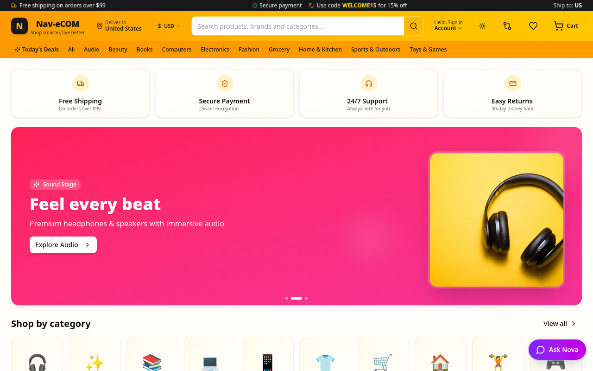
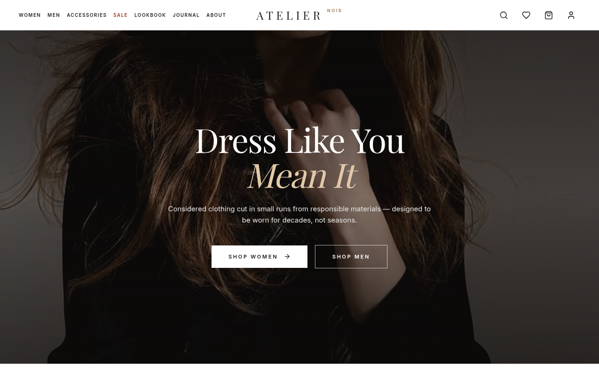
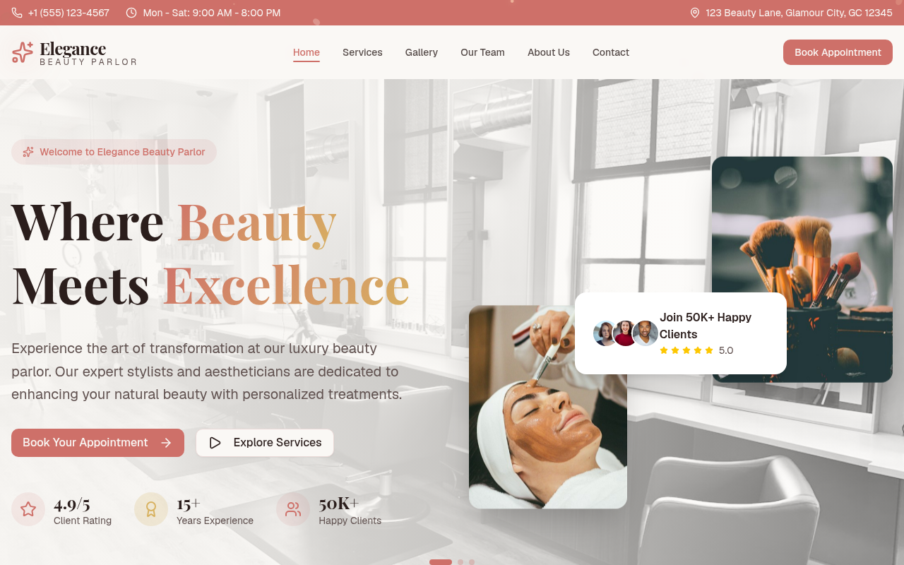

# Hi, I'm Navpreet Singh 👋

I'm a web developer and designer from Amritsar, India. I like building fast, good-looking websites and apps — online stores, college sites, salon pages and small tools like attendance trackers.

🌱 **Currently learning:** backend work with Prisma and databases, and getting better at Android with Kotlin.

## 🛠️ Tech I use

  

## 🚀 Featured projects

### Nav-eCOM
An e-commerce store with categories, product catalogue and cart.
🔗 [nav-ecom.vercel.app](https://nav-ecom.vercel.app)

### Atelier Noir
A storefront for a fashion / clothing brand.
🔗 [atelier-noir-roan.vercel.app](https://atelier-noir-roan.vercel.app)

### Elegance Beauty Parlor
A salon website showing services and booking.
🔗 [beauty-by-nav.vercel.app](https://beauty-by-nav.vercel.app)

### More projects
| Project | What it is | Live |
|---|---|---|
| **AttendAGC** | Attendance tracking web app | [attend-agc.vercel.app](https://attend-agc.vercel.app) |
| **Greenfield University** | University website | [greenfield-university-nu.vercel.app](https://greenfield-university-nu.vercel.app) |
| **Stitch Project** | My first full website project (HTML/CSS) | [stitch-project-nine.vercel.app](https://stitch-project-nine.vercel.app) |

## 📫 Contact
Open to freelance web projects — reach me here on GitHub.
